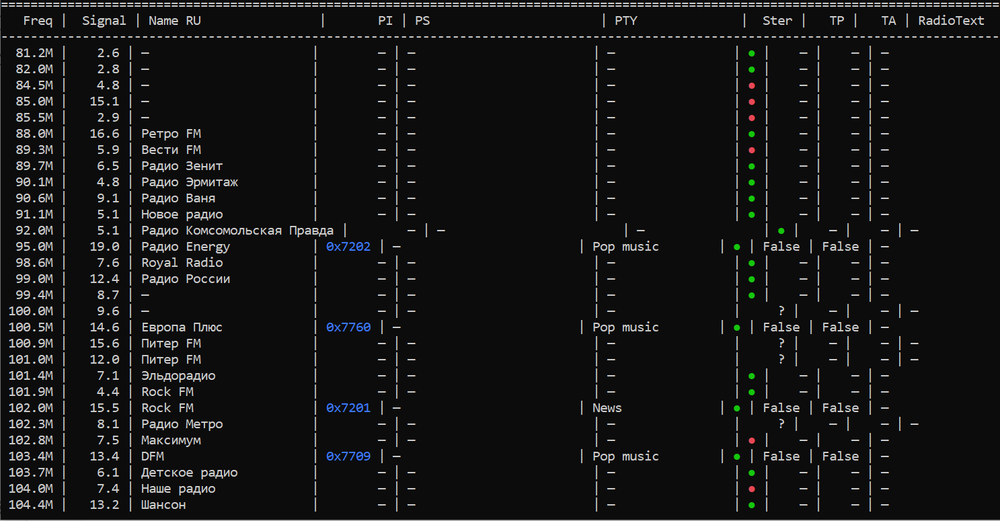
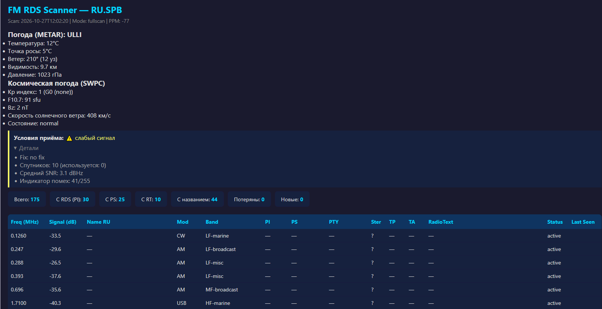
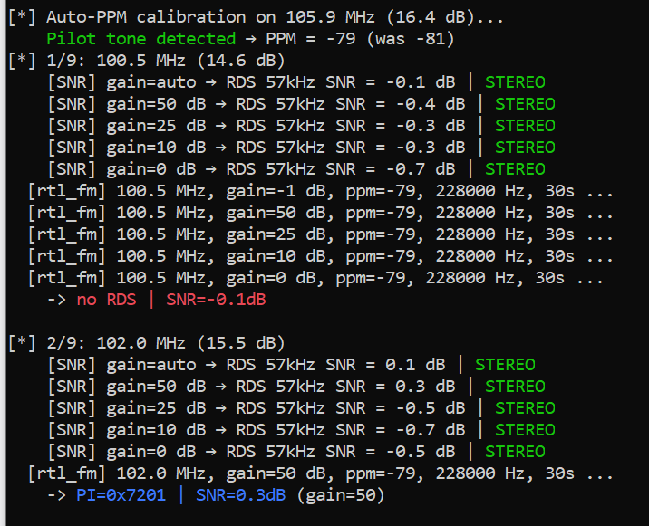

## 🇬🇧 `README.md` (English)

SDR-RTL Scanner (English Version)

**Документация на русском языке:** [README.RU.md](./README.RU.md)

# SDR-RTL Scanner v0.8.7

**A research tool** for automatic scanning of radio bands (FM, OIRT, HF, VHF) using RTL-SDR. It collects RDS data, weather, space weather, and GPS quality context for the research station. The project is focused on building a station database (default: Saint Petersburg) and is easily adaptable to any region.

> **This is not commercial monitoring.** It's a tool for exploring the airwaves, where "Reception conditions" is a measurement context, not a verdict on the causes.

## 🆕 What's new in v0.8.7

*   **Per-station PPM**: each station is calibrated individually (protection against multipath), not based on a single "strongest" one.
*   **`tolerance_mhz=0.1`** in `show_diff`: smooths out "drifting" peaks (e.g., `103.9 ↔ 104.0`) so they aren't considered new/lost.
*   **`PS/PS+` merging**: collects all `PS` variants (even corrupted ones like `M5OARLO`), picks the best by consensus, and merges with frequency/phone into `PS_full` (e.g., `METRO [766-0207]`).
*   **Full `RadioText`**: selects the longest variant from all collected ones.
*   **GPS Quality (4 states)**: `CLEAR` (normal), `INDOOR` (weak signal), `ANOMALY` (no signal), `NO_GPS_HARDWARE` (no module).
*   **"Reception conditions" block in HTML**: traffic light (✅/⚠️/🚨/⚪) with details (fix, satellites, SNR, `jam`), **without coordinates** for privacy.
*   **Region auto-detection**: via GPS/IP with confirmation (`--yes`, `--no-detect`).
*   **`snap` fix**: frequencies are rounded to the scan step (`snap_freq(freq, step_khz)`), not 100 kHz.
*   **`MAX_OVERLAP_MHZ=0.5`**: protection against absurd overlap in wide steps (e.g., `CB-27MHz`).

## 📸 Examples

### Terminal output (RDS and calibration)

*Fig. 1: Per-station PPM and RDS decoding.*

### HTML report (dark theme, "Reception conditions")

*Fig. 2: "Reception conditions" block and station table.*

### Database (JSON)

*Fig. 3: Fragment of the station database.*

## 🚀 Quick Start

### 1. Installing dependencies

**Hardware:** RTL-SDR receiver (RTL2832U) or compatible.

**Software (Linux):**
```bash
# Python libraries
pip install numpy pandas pyrtlsdr

# rtl-sdr utilities (rtl_power, rtl_fm)
sudo apt update && sudo apt install librtlsdr-dev rtl-sdr

# RedSea (RDS decoder) — via snap or build
sudo snap install redsea
# or
# git clone https://github.com/Osso/redsea.git && cd redsea && mkdir build && cd build && cmake .. && make && sudo make install
```

**Verify that the commands are available:
```
rtl_fm -h
rtl_power -h
redsea -h
```

### 2. Running

**Basic FM scan (87.5–108 MHz):
```
python3 SDR_RTL_Scanner.py
```

**Basic FM scan (87.5–108 MHz) with 50 kHz step and 60s dwell:
```
python3 SDR_RTL_Scanner.py --start 88 --stop 108 --step 50 --dwell 60 --yes
```

**Interactive region selection:
```
python3 SDR_RTL_Scanner.py --region '?'
```

**Modes (besides fullscan):
```
python3 SDR_RTL_Scanner.py --mode update   # re-decode RDS from base
python3 SDR_RTL_Scanner.py --mode edit     # manual name_ru editing
python3 SDR_RTL_Scanner.py --mode merge    # merge Update into Base
```

**Results are saved to data/SDR_Update_{region}_{timestamp}.json, HTML report to reports/SDR_Report_{region}_{timestamp}.html

### 3. Main flags (up-to-date)

Flag			Description
--start, --stop		Scan boundaries (MHz). Default 87.5–108.0.
--step			rtl_power step in kHz. For FM, --step 50 is recommended (100 kHz is coarse, causes 100 kHz "drift").
--dwell			Time per station for RDS (sec). For weak signals, --dwell 60 (35 is too little).
--rds-gains		Comma-separated RDS gains (-1 = auto). Default -1,50,25,10,0.
--threshold		Signal threshold (dB). If -35 is too low, auto-threshold kicks in automatically.
--snap			Frequency rounding (kHz). Default 100.
--region		Region in CC.city format (e.g., RU.spb). '?' — interactive.
--yes, -y		Auto-confirm region (for CI/scripts).
--no-detect		Disable auto-detection (only from --region / observer.json).
--antenna		Antenna ID from antennas.json (e.g., ant_001).
--artifact		Propagation anomaly type (e.g., tropospheric_duct).
--interference		Interference type (e.g., power_line).
--no-context		Disable context collection (METAR, SWPC, GPS) for backward compatibility.

**Full list — python3 SDR_RTL_Scanner.py --help

##🛰️ GPS Quality and "Reception Conditions"

The scanner reads data from local gpsd (if running) and forms the general reception context at the time of scanning.
GPS is optional. If there's no module, the program doesn't crash, it just marks the context as "GPS unavailable".

### 4. GPS states

The reports and JSON use a neutral classification:

State (gq_status)	HTML icon	What the program sees

CLEAR	✅ normal	Fix acquired (mode >= 2). Coordinates available (but not shown in HTML for privacy).
INDOOR	⚠️ weak signal	No fix, but satellites with signal are visible (typical for indoors).
ANOMALY	🚨 no signal	No fix, and all visible satellites have ss = 0 (no signal from any).
NO_GPS_HARDWARE	⚪ GPS unavailable	No data from gpsd (module not connected, service off).

## "Reception conditions" block in HTML report

**At the top of the report (next to METAR and space weather), a collapsible block is displayed:

    Reception conditions: ⚠️ weak signal
    ▶ Details

        Fix: no fix

        Satellites: 10 (used: 0)

        Average SNR: 3.1 dBHz

        Interference indicator: 41/255

    Coordinates (lat/lon) are not shown in HTML — only general metrics (for privacy).

    In the JSON file, the observation_context.gps_quality.position field always contains null.

    jam is a numeric gpsd field (0–255). This is not a verdict and not proof of interference, but just an "indicator" from the receiver. Low jam (10–50) is normal.

### GPS Configuration

In config/observer.json, you can specify connection parameters:
```
{
  "gps": {
    "host": "127.0.0.1",
    "port": 2947,
    "timeout": 5.0
  }
}
```
If the section is missing, default values are used.
📻 Working with RDS: PS, PS+ and RadioText

RDS decoding is performed by the rtl_fm + RedSea combo. With a weak signal or multipath, RDS groups may arrive with errors. The scanner uses variant collection and consensus to extract clean data even from "corrupted" packets.
1. PS (Program Service) merging

PS is an 8-character station name transmitted cyclically. With a poor signal, RedSea may produce corrupted variants (e.g., M5OARLO, M*CARLO). The scanner collects all PS variants and applies:

    Hamming clustering: variants with a difference ≤ 2 characters are merged into a cluster.

    Positional consensus: if a cluster contains M5OARLO, M-CARLO, M*CARLO, then at the second position - wins (most frequent), resulting in M-CARLO.

    PS_full: if the station transmits a frequency or phone in PS+, they are added in square brackets.

        Example: METRO [766-02xx] (name + phone).

        Example: VESTI FM [89.3] (name + frequency).

    Important: characters like DOPO*HOE (Dorozhnoe Radio) or * ABTO * (Avtoradio) are legitimate names (transliteration with Ж replaced by *). They are not discarded as "corrupted".

2. Full RadioText

RadioText is transmitted in 64-character blocks. If the signal is interrupted, RedSea may output only part of the text (e.g., RECLAMA). The scanner collects all RadioText variants during dwell and selects the longest (e.g., RECLAMA (812)244-30-xx).
3. RDS Setup

    --dwell 60: if the station is weak (SNR < 4 dB), 35 seconds (default) may not be enough to assemble all RDS groups. 60 seconds gives a better chance.

    --rds-gains "-1,50,25,10,0": gain sweep. Different stations may have different optimal gain.

🗺️ Region Configuration

The system supports any region. All you need is to create the appropriate JSON files.
1. Station reference (name base)

File: regions/{region}.json. The format is simple: a dictionary where the key is the frequency in MHz and the value is the station name.

Example (regions/RU.spb.json):
```json

{
  "schema_version": 1,
  "region": "RU.spb",
  "city": "Saint Petersburg",
  "country": "RU",
  "description": "FM and OIRT stations",
  "stations": {
    "87.5": "Dorozhnoe Radio",
    "88.0": "Retro FM",
    "88.4": "Avtoradio",
    "100.5": "Evropa Plus",
    "102.0": "Rock FM"
  }
}
```

2. Band reference (step, modulation, threshold)

File: regions/radio_bands_reference.json. Describes band boundaries and their default parameters.

Example (fragment):
```json

{
  "bands": [
    {
      "freq_min": 87500,
      "freq_max": 108000,
      "name": "FM-broadcast",
      "modulation": "WFM",
      "threshold": -35.0,
      "step": 100000
    }
  ]
}
```

*Note: frequencies in this file are in kHz (87500 = 87.5 MHz).

If the section is missing, default values are used.
📻 Working with RDS: PS, PS+ and RadioText

RDS decoding is performed by the rtl_fm + RedSea combo. With a weak signal or multipath, RDS groups may arrive with errors. The scanner uses variant collection and consensus to extract clean data even from "corrupted" packets.
1. PS (Program Service) merging

PS is an 8-character station name transmitted cyclically. With a poor signal, RedSea may produce corrupted variants (e.g., M5OARLO, M*CARLO). The scanner collects all PS variants and applies:

    Hamming clustering: variants with a difference ≤ 2 characters are merged into a cluster.

    Positional consensus: if a cluster contains M5OARLO, M-CARLO, M*CARLO, then at the second position - wins (most frequent), resulting in M-CARLO.

    PS_full: if the station transmits a frequency or phone in PS+, they are added in square brackets.

        Example: METRO [766-0207] (name + phone).

        Example: VESTI FM [89.3] (name + frequency).

    Important: characters like DOPO*HOE (Dorozhnoe Radio) or * ABTO * (Avtoradio) are legitimate names (transliteration with Ж replaced by *). They are not discarded as "corrupted".

2. Full RadioText

RadioText is transmitted in 64-character blocks. If the signal is interrupted, RedSea may output only part of the text (e.g., RECLAMA). The scanner collects all RadioText variants during dwell and selects the longest (e.g., RECLAMA (812)244-30-04).
3. RDS Setup

    --dwell 60: if the station is weak (SNR < 4 dB), 35 seconds (default) may not be enough to assemble all RDS groups. 60 seconds gives a better chance.

    --rds-gains "-1,50,25,10,0": gain sweep. Different stations may have different optimal gain.

🗺️ Region Configuration

The system supports any region. All you need is to create the appropriate JSON files.
1. Station reference (name base)

File: regions/{region}.json. The format is simple: a dictionary where the key is the frequency in MHz and the value is the station name.

Example (regions/RU.spb.json):
```json

{
  "schema_version": 1,
  "region": "RU.spb",
  "city": "Saint Petersburg",
  "country": "RU",
  "description": "FM and OIRT stations",
  "stations": {
    "87.5": "Dorozhnoe Radio",
    "88.0": "Retro FM",
    "88.4": "Avtoradio",
    "100.5": "Evropa Plus",
    "102.0": "Rock FM"
  }
}
```

2. Band reference (step, modulation, threshold)

File: regions/radio_bands_reference.json. Describes band boundaries and their default parameters.

Example (fragment):
```json

{
  "bands": [
    {
      "freq_min": 87500,
      "freq_max": 108000,
      "name": "FM-broadcast",
      "modulation": "WFM",
      "threshold": -35.0,
      "step": 100000
    }
  ]
}
```

Note: frequencies in this file are in kHz (87500 = 87.5 MHz).
3. Observer configuration

File: config/observer.json. Specifies the default region, METAR station binding, and (optionally) GPS.
```json

{
  "name": "my_observer",
  "region": "RU.spb",
  "location": {
    "city": "Saint Petersburg",
    "lat": 0.0,
    "lon": 0.0,
    "altitude_m": 0
  },
  "metar_station": "ULLI",
  "gps": {
    "host": "127.0.0.1",
    "port": 2947,
    "timeout": 5.0
  }
}
```

    Privacy: coordinates (lat, lon) are stored locally and not shown in the HTML report. If not needed, leave 0.0.

4. Antenna parameters

File: config/antennas.json. Contains antenna profiles. The scanner can automatically adjust gain if default_gain is specified for the band.
```json

{
  "ant_001": {
    "model": "RTL-FM-Dipole-V1",
    "type": "dipole",
    "gain_dbi": 2.15,
    "frequency_range_mhz": [87.5, 108.0],
    "default_gain": 25
  }
}
```

How to add a new region (e.g., Moscow)

    Create regions/RU.msk.json based on RU.spb.json.

    If you want it as default, change "region": "RU.msk" in config/observer.json.

    Run: python3 SDR_RTL_Scanner.py --region RU.msk --start 88 --stop 108 --yes.

🔒 Privacy and Coordinates

The project is designed as a research tool for personal use. We understand that exact reception coordinates can be sensitive information. Therefore, the scanner implements the principle "coordinates — local only":

    No coordinates in HTML reports. The report shows only the region and the "Reception conditions" block (GPS state, satellite count, jam), but never latitude and longitude.

    Coordinates zeroed in JSON files. When saving scan results to data/SDR_Update_*.json, the observation_context.gps_quality.position field is always forced to null. This protects against accidental leaks if you share the JSON file.

    Local storage. If you save coordinates for later use, they are stored only in config/observer.json on your device.

Recommendations for Git users

The config/observer.json file may contain your personal data. If you plan to publish your repository, it is strongly recommended to add this file to .gitignore:
text

# .gitignore
config/observer.json

🔬 Status: Research Project

This scanner is conceived and developed as a research tool for enthusiasts exploring the airwaves.

What this means:

    Context, not verdict. The "Reception conditions" block and GPS metrics (including jam) are just numeric facts (how many satellites are visible, what DOP, what the interference indicator level is). The program does not draw conclusions about the causes of these phenomena (weather, buildings, interference, or something else). Interpretation is not part of the researcher's tasks.

    Physical limitations. Cheap RTL-SDRs have their limits: 8-bit ADC (prone to overload), limited adjacent channel selectivity. Therefore, literally everything affects the results: antenna quality, position in the room, time of day.

    Receive only. The script does not contain functionality for generating interference, controlling transmitters, or unauthorized access to networks. Only passive scanning and RDS decoding.

    No guarantees. The program is provided "as is" (see MIT license). The authors are not responsible for the use of results for commercial or regulatory purposes.

📁 Project Architecture
```text

SDR-RTL-Scanner/
├── assets/            # Documentation screenshots
├── config/            # Configurations
│   ├── observer.json  # Observer settings (region, GPS, METAR)
│   ├── antennas.json  # Antenna profiles
│   └── system.py      # System constants (thresholds, defaults)
├── core/              # Scanner core
│   ├── scanner.py     # Scanning (rtl_power)
│   ├── snr.py         # RDS decoding (redsea)
│   ├── context.py     # METAR, SWPC, GPS collection
│   ├── gps_quality.py # GPS analysis (4 states)
│   └── gq_adapter.py  # GPS adapter for Context
├── data/              # Bases and updates (JSON)
├── regions/           # Region and band references
├── reports/           # HTML reports
├── utils/             # Research scripts (e.g., test_gps_quality.py)
├── SDR_RTL_Scanner.py # Main script
└── _version.py        # Version
```

⚠️ Limitations and Known Issues

    Frequency resolution. For FM, --step 100 (default) may be coarse: the station peak "floats" by ±100 kHz. Use --step 50 for precise positioning.

    Weak signal and RDS. At SNR < 4 dB, RDS decoding is physically impossible. Increasing --dwell (e.g., to 60 s) increases the chances but does not guarantee results.

    Multipath. In urban environments, the signal arrives from different directions, causing interference. This affects RDS quality.

    Band edges. rtl_power has artifacts at the edges of the scanned band (DC spike, frequency response roll-off), so edge frequencies may be determined inaccurately.

🤝 How to Contribute

The project is open to researchers and enthusiasts:

    Tests: writing unit tests (pytest) for show_diff, snr.py, scanner.py — this will greatly improve reliability.

    Refactoring: splitting SDR_RTL_Scanner.py into modules (cli, modes, io, report).

    New regions: adding references for other cities.

    Documentation: installation experience on Windows/macOS or working with other hardware (e.g., Miri SDR).

Create an Issue or send a Pull Request. Any help is welcome!
📜 License

The project is distributed under the MIT license. See the LICENSE file for details.
